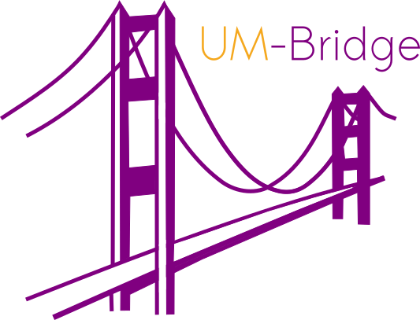

# UM-Bridge Workshop 2026

UM-Bridge is a language-agnostic interface linking Uncertainty Quantification (UQ) packages and numerical model software. It allows

* Speeding up UQ projects from prototype to HPC
* Making UQ and model software available to a wide audience
* Reproducible, community-driven UQ benchmarking

For more information, see [UM-Bridge documentation](https://um-bridge-benchmarks.readthedocs.io/en/docs/).

This workshop has the following goals:

* Get users familiar with UM-Bridge
* Initiate collaborations between UQ and model experts
* Advance the UQ software ecosystem

## Organizers

* Anne Reinarz [anne.k.reinarz@durham.ac.uk](mailto:anne.k.reinarz@durham.ac.uk)
* Chung Ming Loi [chung.m.loi@durham.ac.uk](chung.m.loi@durham.ac.uk)

## Time and Location

The workshop will be held online and span two half days:
* Monday, December 7 2026, 13:00 - 17:00 CET
* Tuesday, December 8 2026, 13:00 - 17:00 CET

## Registration

Registration is available through the [registration form](https://forms.gle/Xm4GZDuPttLW1Psf8).

## Prerequisites

For practical exercises, you will need working installations of
* docker (available at [docker.com](https://www.docker.com/))
* Python

## Schedule
Monday, 7 December 2026

| Time  | Session                                                                                       |
| ----- | --------------------------------------------------------------------------------------------- |
| 13:00 | Welcome                                                                                       |
| 13:05 | Anne Reinarz (Durham University): Introduction to UM-Bridge                                   |
| 13:40 | Practical: UM-Bridge basics / Participants' projects                                          |
| 14:20 | TBD : Intro containers, containerized UM-Bridge models/benchmarks                             |
| 14:40 | Practical: Containerized models / Participants' projects                                      |
| 15:00 | Coffee break                                                                                  |
| 15:30 | Andrea Morini: Technical University of Braunschweig                                           |
|       | Title: StatFEMEUCLID.jl: Data assimilation and model discovery supported by UMBridge.jl       |
| 15:45 | Rui Carvalho, Durham University                                                               |       
|       | Title: Fast and Principled Equation Discovery from Chaos to Climate                           |       
| 16:00 | Alice Gabriel, UC San Diego                                                                   |
|       | Title: Uncertainty quantification for earthquake dynamic rupture simulations with SeisSol     |
| 16:30 | Laura Scarbosio, Radboud University and Juliette Dubois, TU Berlin                            |
|       | Title: TBD                                                 |
| 17:00 | Wrap up                                                                                       |

Tuesday, 8 December 2026

| Time  | Session                                                                 |
| ----- | ----------------------------------------------------------------------- |
| 13:00 | Chung Ming Loi (Durham University): UM-Bridge models in the cloud and on classical HPC               |
| 13:30 | Practical: UM-Bridge cloud + HPC / Participants' projects        |
| 14:00 | Short break / discussion                                                |
| 14:30 | Mario Wille, Technical University of Munich                                            |
|       | Title: TBD                                                       |
| 15:00 | Chung Ming Loi, Durham University                                            |
|       | Title: TBD                                                |
| 15:30 | Coffee break                                                            |
| 16:00 | Lightning talks (various)                                                             |
| 16:20 | Invited Talk: TBD                       |
| 16:50 | Closing Remarks / Wrap-up                                               |

## Abstracts

Speaker: Andrea Morini
Title: StatFEMEUCLID.jl: Data assimilation and model discovery supported by UMBridge.jl

Abstract: A recent publication in the solid mechanics community provides an algorithm which combines a Bayesian based assimilation technique (statFEM) with an unsupervised calibration-discovery method (EUCLID), which aims to provide a reliable prognosis in the context of sparse and noisy displacement measurements. 
The method showed promising results for synthetic data so that it was decided to provide a software package, StatFEMEUCLID.jl, that can be integrated in the existing framework concerning either the uncertainty quantification or the model calibration topic. 
StatFEM-EUCLID relies on the solution of a finite element model and therefore requires an interface with a FE solver. Given the wide variety of solvers available in the computational mechanics community, including in-house implementations developed by individual research groups, we designed the StatFEMEUCLID.jl package around UM-Bridge. This choice promotes reproducibility and flexibility from the user to the choice the FE solver is more comfortable with.

Speaker: Rui Carvalho
Title: Fast and Principled Equation Discovery from Chaos to Climate

Abstract: Our ability to predict, control and understand complex systems rests on discovering their governing equations. Existing methods for identifying them from noisy and limited observations force a compromise between automation, statistical rigor and computational efficiency. Here we develop Bayesian-ARGOS, which combines rapid frequentist screening of a large candidate library with Bayesian inference on the terms retained, enabling automated equation discovery with principled uncertainty quantification, conditional on the screened candidate library, at a fraction of the computational cost of existing methods. On seven chaotic systems, Bayesian-ARGOS recovers the equations more reliably than two established methods in most cases, and its diagnostics explain why more data or less noise can lower the success rate. Integrated with representation learning, it identifies the latent dynamics of global sea-surface temperature, consistently recovers the annual cycle and shows that the uncertainty usually leaves undecided whether the slow variation grows or decays. Bayesian-ARGOS opens automated, uncertainty-aware equation discovery to climate science and other fields seeking mechanistic understanding.

Speaker: Alice Gabriel
Title: Uncertainty quantification for earthquake dynamic rupture simulations with SeisSol

Abstract: Physics-based dynamic rupture simulations couple fault friction, earthquake source processes and seismic wave propagation, but their inputs (fault stresses, friction parameters, subsurface structure) are poorly constrained. I will show how we combine the open-source software SeisSol, running on supercomputers, with UM-Bridge for uncertainty quantification of earthquake rupture models, and discuss other UQ applications in our group that do not (yet) use UM-Bridge, with lessons learned for coupling large HPC codes to UQ workflows.

